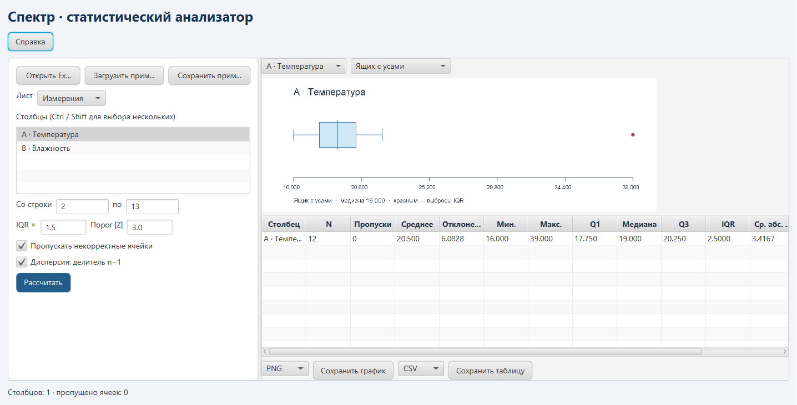

# Лабораторная работа № 4. «Спектр»

Настольный анализатор числовых данных Excel. Программа рассчитывает статистики для выбранных столбцов, показывает выбросы и сохраняет графики и сводную таблицу. Цель работы — построить обработку по паттерну **каналы и фильтры** (Pipes and Filters).



## Запуск

Из папки `lab4` выполните `mvn javafx:run`. Из общей папки в Windows выполните `.\labs.cmd 4`. Нужны JDK 21+ и Maven.

## Быстрый пример

1. Нажмите **Загрузить пример** или **Открыть Excel** и выберите файл `.xls` или `.xlsx`. Первая строка листа содержит заголовки.
2. Выберите лист, выделите нужные столбцы (Ctrl или Shift для нескольких) и задайте диапазон строк. При необходимости переключите флажок **Дисперсия: делитель n−1**.
3. Нажмите **Рассчитать**. Для столбца «Температура» во встроенном примере медиана равна 19, межквартильный размах равен 2,5, а 39 определяется как выброс IQR при пороге 1,5.
4. Выберите один из рассчитанных столбцов и тип графика. Доступны диаграмма размаха и скрипичная диаграмма.
5. Сохраните график в PNG, SVG, PDF или HTML, а сводную таблицу — в CSV, XLSX, JSON или Markdown. **Сохранить пример** выгружает демонстрационную книгу для просмотра в Excel.

Числа в текстовых ячейках поддерживают десятичную точку и запятую. Если пропуск некорректных ячеек выключен, программа укажет столбец и номер первой проблемной строки. В сводке отображаются количество наблюдений, среднее, стандартное отклонение, минимум и максимум, квартили, IQR, среднее абсолютное отклонение от среднего и выбросы IQR и Z-score.

## Как устроен конвейер

```text
Запрос → load → parse → prepare → compute → список результатов
```

`Pipeline<I, O>` соединяет шаги так, чтобы выход одного совпадал по типу со входом следующего. `Analysis.load` читает выбранный диапазон через Apache POI, `parse` преобразует ячейки в числа, `prepare` проверяет объём данных и сортирует, `compute` рассчитывает статистики. `Plot` и `Export` работают с результатами расчёта. `Main` запускает чтение и расчёт в фоне, чтобы окно оставалось доступным.

Квартили вычисляются линейной интерполяцией. Выброс IQR лежит за пределами `Q1 − k·IQR` и `Q3 + k·IQR`, выброс Z-score превышает выбранный порог по модулю. Стартовые значения `k = 1.5` и `|z| = 3.0` берутся из `src/main/resources/application.properties` и меняются в окне приложения.

## Расчёты и форматы

| Показатель | Как рассчитывается |
| --- | --- |
| Межквартильный размах | `IQR = Q3 − Q1`. Значения за пределами `[Q1 − k·IQR, Q3 + k·IQR]` считаются выбросами. |
| Z-score | `z = (x − среднее) / стандартное отклонение`. Выбросы определяются по `abs(z) > порог`. При нулевом стандартном отклонении выбросов по этому критерию нет. |
| Среднее абсолютное отклонение | Сумма абсолютных разностей между наблюдениями и средним делится на число наблюдений. |
| Стандартное отклонение | Корень из дисперсии. Флажок **Дисперсия: делитель n−1** включает выборочную формулу. При снятом флажке используется делитель `n`. |

Ящик с усами показывает квартили, медиану и IQR-выбросы. Скрипичный график показывает оценку плотности распределения. Кнопка **Справка** открывает подсказку по подготовке книги, расчёту и экспорту.

| Что сохраняется | Форматы |
| --- | --- |
| График выбранного столбца | PNG, SVG, PDF, HTML |
| Сводка по всем рассчитанным столбцам | CSV, XLSX, JSON, Markdown |

## Тестирование

В каталоге `lab4` выполните `mvn test`. [AnalysisTest.java](src/test/java/ru/semenyutin/lab4/AnalysisTest.java) проверяет квартили и выбросы на известных данных, оба делителя дисперсии, чтение формул Excel и десятичной запятой, обработку нечисловых ячеек и экспорт.

## Технологии

- **Java 21 и JavaFX** — запуск расчёта и интерфейс.
- **Apache POI** — чтение Excel и запись XLSX.
- **Java2D и Apache PDFBox** — отрисовка и сохранение графиков.
- **Maven и JUnit 5** — сборка и автотесты.

## Структура проекта

| Файл | Назначение |
| --- | --- |
| [Pipeline.java](src/main/java/ru/semenyutin/lab4/Pipeline.java) | Типизированное соединение этапов. |
| [Analysis.java](src/main/java/ru/semenyutin/lab4/Analysis.java) | Чтение, подготовка и расчёт. |
| [Plot.java](src/main/java/ru/semenyutin/lab4/Plot.java) | Отрисовка двух видов графиков. |
| [Export.java](src/main/java/ru/semenyutin/lab4/Export.java) | Сохранение графика и сводки. |
| [application.properties](src/main/resources/application.properties) | Пороги IQR и Z-score по умолчанию. |
